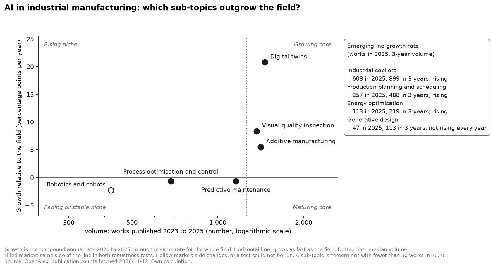
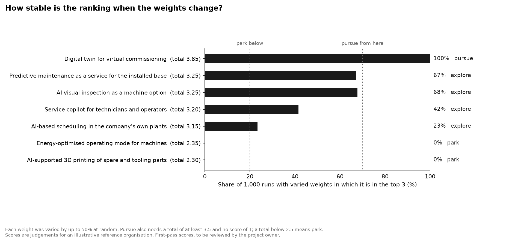

# Ino_Mgmt

Notes, tools and case work on innovation management.

This repository collects applied material on how organisations find, evaluate and scale new ideas: concise framework write-ups, case analyses of public companies, reusable templates, and periodic trend scans.

*Eine deutsche Kurzfassung der beiden Analysen: [Kurzfassung](docs/zusammenfassung-de.md).*

## Highlights

Two connected analyses on one theme, **AI in industrial manufacturing**, built on a reproducible data pipeline.

### 1. Trend scan: which application areas are gaining ground?

Research on AI in manufacturing grew about 35% a year from 2020 to 2025. Measured against that pace, digital twins, visual quality inspection and additive manufacturing are pulling ahead; industrial copilots show the steepest rise but no confirmed production use; predictive maintenance and robotics are large but only keep pace. Publication counts are checked against a second signal, adoption in industry.

[](trend-scans/2026-11_ai-in-industrial-manufacturing.md)

→ [Read the trend scan](trend-scans/2026-11_ai-in-industrial-manufacturing.md)

### 2. Opportunity scoring: what should a machine builder do first?

A reusable scoring model, applied to the seven shortlisted areas for a fictional machine builder. One opportunity, a digital twin for virtual commissioning, ranks first in every one of 1,000 runs with varied weights. Four others are too close to call, and the model says so instead of forcing a ranking.

[](tools/opportunity-scoring/)

→ [Read the scoring model and its results](tools/opportunity-scoring/)

### 3. How the project was run

A small project, managed like a real one:

- a [project charter](docs/project/01-project-charter.md) with scope, priorities and success criteria;
- [requirements with testable acceptance criteria](docs/project/02-requirements-and-plan.md), and every change request recorded with its reason;
- **methods fixed before the data was seen**: the [trend scan method](docs/design/trend-scan-method.md) and the [scoring method](docs/design/scoring-model-method.md) were approved before any result existed, and the Git history shows the order;
- a [critical review](docs/design/design-review.md) of the plan and both methods before building;
- work tracked as [issues](https://github.com/CMkc34/Ino_Mgmt/issues), delivered through reviewed pull requests with automatic checks on Linux and Windows.

## Focus

- **Theme of the current work:** AI in industrial manufacturing
- **Methods:** technology foresight and trend analysis, data-driven opportunity assessment, cost-benefit reasoning
- **Tools:** Python; data from OpenAlex

## Structure

| Folder | Contents |
|---|---|
| [`trend-scans/`](trend-scans/) | Dated scans of industries and emerging technologies |
| [`tools/`](tools/) | Reusable tools: the opportunity scoring model |
| [`docs/design/`](docs/design/) | Method notes and the design review |
| [`docs/project/`](docs/project/) | Project charter, requirements and plan, status |
| [`pipelines/`](pipelines/) | Python data pipeline: fetch, calculate, draw |
| [`data/`](data/) | Source snapshots (`raw/`), hand-maintained inputs (`manual/`) and results (`processed/`) |
| [`outputs/`](outputs/) | Charts produced by the pipeline |
| [`tests/`](tests/) | Automatic tests of the calculations, the charts and the documents |
| [`frameworks/`](frameworks/) | Framework write-ups: [Three Horizons](frameworks/three-horizons.md), applied to the scoring results |
| [`case-studies/`](case-studies/), [`notes/`](notes/) | Planned; see the [roadmap](ROADMAP.md) |

## Approach

- **Applied over theoretical:** every method comes with a worked example.
- **Evidence-based:** claims cite public sources; assumptions are marked as assumptions.
- **Reproducible:** one command rebuilds every table and chart from the stored data.
- **Honest about limits:** each analysis states what it cannot show.

## How this work was made

This project was built with an AI assistant (Claude Code), and the division of work is stated here so nothing is misread.

- **By the project owner:** the scope and priorities, the decisions on method (approved before any data was fetched), the checks of the assistant's work, the rules and levels for adoption, the choice of the shortlist, and the review and final wording of the scores and the written analyses.
- **By the AI assistant, at the owner's direction:** the Python code and its tests, the data fetch, drafts of the project documents and method notes, a first rating of the search results, the search for and checking of adoption sources, first drafts of the scores and of the written analyses, and reviews, including a critical review of its own designs.

The project documents record each decision and change request, and the Git history shows who committed what.

## Running the pipeline

Requires Python 3.12.

```
python -m venv .venv            # then activate it
python -m pip install -r requirements.txt
python -m pytest
python -m pipelines run all
```

Step-by-step instructions for Windows are in [`docs/setup-windows.md`](docs/setup-windows.md). The pipeline reads a stored snapshot of the source data, so a normal run needs no network access. Parameters are in [`config.yaml`](config.yaml).

## Licence

- **Code** (scripts, notebooks, pipeline): [MIT](LICENSE)
- **Text and figures** (write-ups, case studies, trend scans, documentation): [CC BY 4.0](LICENSE-CONTENT.md)

## Status

Both analyses are complete drafts under the project owner's review. See the [project charter](docs/project/01-project-charter.md) for scope and schedule, the [status notes](docs/project/status.md) for progress, and the [roadmap](ROADMAP.md) for what comes next.
