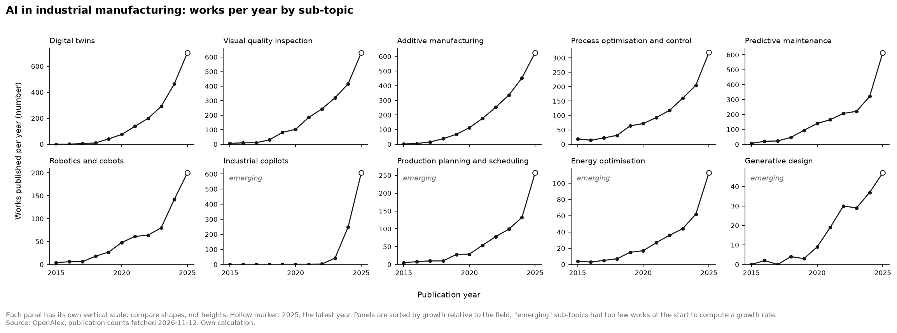

# DMG MORI: the digital twin as a product, not only as an engineering tool

| | |
|---|---|
| **Type** | Case study, outside-in, from public sources |
| **Status** | Draft for the project owner's review |
| **Company** | DMG MORI, a global manufacturer of machine tools |
| **Topic** | Digital twins, the top-ranked area of the [trend scan](../trend-scans/2026-11_ai-in-industrial-manufacturing.md) and the [opportunity scoring](../tools/opportunity-scoring/) |
| **Sources checked** | 13 November 2026 |

> **What this is.** An analysis from the outside, based on what the company and its partner Siemens publish. Nearly all figures are their own marketing claims. No inside knowledge, no financial data on the offering, and no independent measurement was available.

## Summary

DMG MORI, a machine-tool builder, sells a digital twin of each customer's machine. With Siemens it offers twins of the controller, the machine and the workpiece, so customers can program and test before the real machine runs. The companies claim up to 40% faster production ramp-up and up to 75% less unproductive machine time; one named customer reports about 20% higher performance. For the fictional machine builder of this project, the case shows a second use the scoring had not considered: the twin as a paid offering to customers, not only as an internal tool for commissioning. It shows the price of the fast route: the offering is built on one supplier's control system. The claims are the sellers' own best-case figures; no independent evidence was found.

**Takeaway:** score the digital twin twice, as an internal tool and as an offering, and measure its effect before quoting anyone else's numbers.

## 1. Context

DMG MORI builds machine tools: turning and milling machines that other manufacturers use to make metal parts. It describes itself as a leading global manufacturer with more than 12,000 employees in 43 countries ([Siemens, company description on the case page](https://www.siemens.com/en-us/company/insights/dmg-mori-machining-digital-twin/)).

Its customers have a recurring problem. A new machine earns nothing until programs are written, tested and the operators are trained, and a programming error on a real machine can cause a collision, scrap and damage. Testing on the machine also blocks it for production.

The wider picture, from this project's trend scan: digital twins are the fastest-growing AI application area in manufacturing research, 20.8 percentage points a year above the field, and the only area with the highest adoption level.

*Research on digital twins in manufacturing (first panel) grew from 76 works in 2020 to 705 in 2025. Source: OpenAlex, own calculation; see the trend scan.*

## 2. The decision

DMG MORI chose to make the digital twin part of what it sells, in two steps that are visible in public sources.

**2022: its own offering.** At its open house in Pfronten in September 2022 the company presented the "DMG MORI Digital Twin" for product creation, production and the machine's life cycle. It advertised 40% faster production ramp-up, up to 30% cost reduction through less testing on the machine, a 100% collision-free run-in, and training costs reduced by up to 50% because staff can be trained before the machine arrives. It also described the digital engineering of automated manufacturing systems, built and tested virtually in advance, with "smooth installation and commissioning" as a benefit ([DMG MORI, Open House Pfronten 2022](https://ca-en.dmgmori.com/news-and-media/news/open-house-pfronten-2022-digital-twin)).

**2023: a joint offering with Siemens.** The two companies offer digital twins of the controller, the customer-specific machine and the workpiece, built on Siemens' control system Sinumerik One and sold through Siemens' marketplace. The claims: up to 40% faster production ramp-up, fewer programming errors and collisions, and up to 75% less unproductive machine time, because testing moves from the real machine to the virtual one ([Siemens](https://www.siemens.com/en-us/company/insights/dmg-mori-machining-digital-twin/)).

What the company did **not** do, as far as the sources show: build the controller twin itself. It combined its machine model with its supplier's control software.

## 3. Analysis

### 3.1 Through the Three Horizons

Using the [Three Horizons](../frameworks/three-horizons.md) lens:

- **Horizon 1, the core.** A digital twin delivered with the machine makes the existing product more attractive: the customer is productive sooner. This defends and extends machine sales.
- **Horizon 2, a possible new business.** The 2022 announcement goes further than the machine: training before delivery, programming with simulation, and "data and knowledge-based service" over the machine's life. That is the outline of a service business built on the twin.
- **The route chosen.** By building on Siemens' controller twin, DMG MORI reached the market with a standard that customers already know. The Horizon 2 business, if it grows, will partly be shared with the partner whose marketplace sells it.

The move reads as a Horizon 1 step that keeps a Horizon 2 option open.

### 3.2 Through this project's scoring criteria

An outside-in reading against the five criteria of the [scoring rubric](../tools/opportunity-scoring/rubric.md). These are qualitative judgements, not scores: a real company cannot be scored from its press material.

| Criterion | Reading | Basis |
|---|---|---|
| Market attractiveness | Plausibly high, unproven | The value sits with the customer (faster ramp-up, fewer collisions). Whether customers pay for the twin, and how much, is not published |
| Technical feasibility | High | Built on a commercial control system with an existing digital twin; one customer is named as using it in production |
| Strategic fit | High | Differentiates the machine and opens a route to services |
| Time to value | Short for the customer | Programs and training can be ready before delivery |
| Risk | The main weakness | The offering depends on one supplier's control system and marketplace. Under the rubric, dependence on a single supplier is what a low risk score describes |

### 3.3 What this means for the project's reference company

The scoring model defined the digital twin opportunity as an **internal** tool: testing control software before a machine is assembled, to save commissioning hours. DMG MORI's public case is about something else: a twin **for the customer**.

- The benefit DMG MORI advertises is the customer's ramp-up time and machine availability, not the builder's own commissioning hours. The business case in the scoring guide rests on commissioning hours saved, a driver this case neither supports nor contradicts.
- The two uses are not alternatives. The model built for internal commissioning is the same model that can be handed to the customer.

## 4. Outcome

What is documented:

- **One named customer result.** Rusch Maschinenteile, a German family-owned parts manufacturer, runs a DMG MORI turn-mill machine with Sinumerik One and reports about 20% higher performance through shorter cycle times ([Siemens](https://www.siemens.com/en-us/company/insights/dmg-mori-machining-digital-twin/)).
- **Company claims with "up to".** 40% faster ramp-up, up to 30% lower cost, up to 75% less unproductive machine time, up to 50% lower training cost.

What is not documented in the sources found:

- how many machines are sold with a digital twin;
- what customers pay for it, or what it adds to revenue or margin;
- any measurement by a party other than the two companies and their customer;
- what happened in cases where it did not work.

**Assessment:** the decision is clear and the offering exists. Its commercial outcome cannot be judged from public sources.

## 5. Takeaways

1. **A digital twin can be scored twice.** As an internal tool it is a Horizon 1 efficiency step; as an offering it differentiates the product and may start a service business. The reference case scored only the first. Splitting it would be a fair next version of the scoring.
2. **Partnering buys speed and costs independence.** Building on the control supplier's twin made the offering standard and quick to reach the market. It also ties the offering to that supplier. A smaller machine builder would face the same trade-off, with less bargaining power.
3. **The value may sit with the customer.** If the main benefit is the customer's faster ramp-up, the question is whether the builder can charge for it or has to give it away to win the order. This is the same uncertainty the scoring found for predictive maintenance.
4. **"Up to" is not evidence.** Every percentage in this case is a best case reported by the seller. A company considering the same step should measure its own commissioning and ramp-up times before and after, on one machine type, before it quotes a number.

## 6. Limitations

- All sources are the company's and its partner's own publications. Two pages were opened and checked on 13 November 2026; the claims are quoted as claims.
- The case covers what was announced, not what was achieved.
- One company is one example. It does not show that the approach works for machine builders in general.
- The date of the joint offering (September 2023) comes from a search result and was not confirmed on the opened page.

## 7. Sources

- DMG MORI, "Open House Pfronten 2022 – Digital Twin", 5 September 2022: https://ca-en.dmgmori.com/news-and-media/news/open-house-pfronten-2022-digital-twin
- Siemens, "DMG MORI machining digital twin" (case page with the Rusch Maschinenteile example): https://www.siemens.com/en-us/company/insights/dmg-mori-machining-digital-twin/
- Trend data: [`data/processed/trend_metrics.csv`](../data/processed/trend_metrics.csv), [`data/processed/trend_counts_by_year.csv`](../data/processed/trend_counts_by_year.csv)
