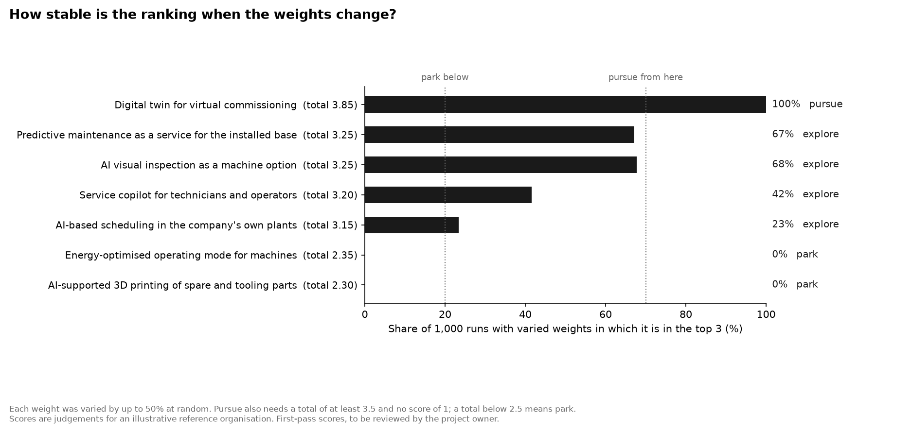
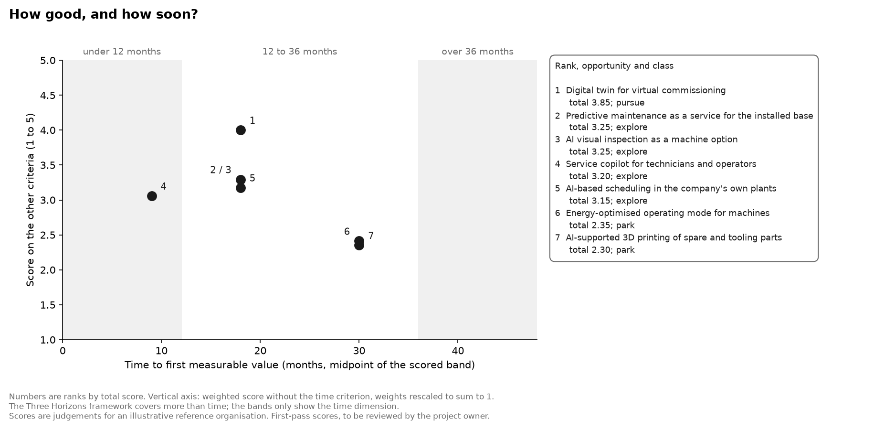

# Opportunity scoring model

| | |
|---|---|
| **Type** | Reusable tool with a worked example |
| **Status** | Draft for the project owner's review (see "Open decisions" at the end) |
| **Method** | [Scoring model method v1.0](../../docs/design/scoring-model-method.md), approved before any opportunity was scored |
| **Input** | The shortlist of the [trend scan](../../trend-scans/2026-11_ai-in-industrial-manufacturing.md), applied to a fictional [reference organisation](reference-organisation.md) |
| **Results** | [`scoring_ranking.csv`](../../data/processed/scoring_ranking.csv) and three more tables in [`data/processed/`](../../data/processed/) |

> **Illustrative.** The organisation is fictional and the scores are first-pass judgements. This is a method with a worked example, not a finding about any real company.

## Summary

This model ranks opportunities for one organisation on five weighted criteria (value, feasibility, strategic fit, time and risk, each scored 1 to 5) and tests how far the ranking can be trusted. Here it is applied to seven AI opportunities for a **fictional** machine builder. **A digital twin for virtual commissioning** scores 3.85 of 5, ranks first in all 1,000 runs with varied weights, and alone meets the bar for "pursue". Four others (predictive maintenance as a service, AI visual inspection, a service copilot, AI-based scheduling) score 3.15 to 3.25: too close to rank, because one point on a single estimated score reorders them. Two (an energy-saving machine mode, 3D printing of parts) score under 2.5 and are parked.

**Recommendation for the example company:** start with the digital twin. Do not rank the four close ones; first firm up the estimate that decides each, mostly its yearly value.

## 1. How the model works

1. Each opportunity gets a score from 1 to 5 on five criteria, with a justification and evidence ([rubric](rubric.md)).
2. The total is the weighted sum of the scores.
3. The ranking is recomputed 1,000 times with randomly varied weights.
4. Each score that rests on an assumption is moved by one point, to see what changes.
5. A rule fixed in advance sorts each opportunity into **pursue**, **explore** or **park**.
6. For the two top-ranked opportunities, a rough business case gives the payback and the break-even point.

| Class | Rule |
|---|---|
| Pursue | In the top three in at least 70% of runs, **and** a total of at least 3.5, **and** no score of 1 |
| Park | In the top three in fewer than 20% of runs, **or** a total below 2.5 |
| Explore | Everything else |

**Weights.** They were set before scoring (decision OD-5) and not changed afterwards.

| Criterion | Weight | Reasoning (first draft, for the owner to confirm) |
|---|---|---|
| Market attractiveness | 0.25 | With a digital budget of about EUR 2 million a year, an opportunity has to be worth enough to matter |
| Technical feasibility | 0.25 | A data team of about ten cannot carry research-stage technology; what cannot be built is worth nothing |
| Strategic fit | 0.20 | Important, but the three goals are broad, so most opportunities fit at least one |
| Time to value | 0.15 | A cautious, family-owned company wants early proof, but not at the price of the larger prize |
| Risk | 0.15 | Matters to cautious owners; kept below value and feasibility because most risks here can be limited by starting small |

## 2. The opportunities

Each is one shortlisted area of the trend scan, turned into a concrete use for the reference organisation ([`opportunities.csv`](reference-case/opportunities.csv)).

| Opportunity | From trend scan area | Use |
|---|---|---|
| Digital twin for virtual commissioning | Digital twins | internal |
| AI visual inspection as a machine option | Visual quality inspection | offering |
| AI-supported 3D printing of spare and tooling parts | Additive manufacturing | internal |
| Service copilot for technicians and operators | Industrial copilots | offering |
| AI-based scheduling in the company's own plants | Production planning and scheduling | internal |
| Energy-optimised operating mode for machines | Energy optimisation | offering |
| Predictive maintenance as a service for the installed base | Predictive maintenance | offering |

## 3. Results

### 3.1 Ranking

Scores in the order market, feasibility, fit, time, risk. All 35 scores with their justification and evidence are in [`scores.csv`](reference-case/scores.csv).

| Rank | Opportunity | Mkt | Feas | Fit | Time | Risk | Total | Top 3, varied weights | Top 3, free weights | Class |
|---|---|---|---|---|---|---|---|---|---|---|
| 1 | Digital twin for virtual commissioning | 4 | 4 | 4 | 3 | 4 | **3.85** | 100% | 100% | pursue |
| 2 | Predictive maintenance as a service for the installed base | 3 | 3 | 5 | 3 | 2 | **3.25** | 67% | 49% | explore |
| 3 | AI visual inspection as a machine option | 3 | 4 | 3 | 3 | 3 | **3.25** | 68% | 46% | explore |
| 4 | Service copilot for technicians and operators | 3 | 3 | 4 | 4 | 2 | **3.20** | 42% | 54% | explore |
| 5 | AI-based scheduling in the company's own plants | 3 | 3 | 3 | 3 | 4 | **3.15** | 23% | 47% | explore |
| 6 | Energy-optimised operating mode for machines | 2 | 2 | 3 | 2 | 3 | **2.35** | 0% | 0% | park |
| 7 | AI-supported 3D printing of spare and tooling parts | 2 | 2 | 2 | 2 | 4 | **2.30** | 0% | 4% | park |

**Practically tied:** ranks 2 to 5 (totals 3.15 to 3.25) and ranks 6 and 7. The recommendation does not rest on their order. Ranks 2 and 3 have the same total; their order in the table is alphabetical.

### 3.2 How far the ranking depends on the weights

- **Rank 1 is dominant.** The digital twin is first in all 1,000 runs with weights varied by up to 50%, and in the top three in all 1,000 runs with freely drawn weights.
- **Swap point for ranks 1 and 2:** only one criterion can swap them. Predictive maintenance overtakes the digital twin if the weight of strategic fit rises from 0.20 to 0.51. No change to any other single weight does it ([`scoring_swap_points.csv`](../../data/processed/scoring_swap_points.csv)).
- **The middle group has no stable order.** None of ranks 2 to 5 reaches the 70% needed for "pursue". Under free weights their top-three shares are all between 46% and 54%: which of them comes out ahead is a matter of what the organisation values, not of the scores.

### 3.3 How far the ranking depends on uncertain scores

19 of the 35 scores rest on an assumption, mainly the value estimates and the time estimates. Each was moved one point up and down, one at a time ([`scoring_uncertain_scores.csv`](../../data/processed/scoring_uncertain_scores.csv)).

- **The digital twin holds.** With either of its uncertain scores one point lower, its total is still at least 3.60 and it stays first.
- **The middle group does not.** One point more on market attractiveness lifts either predictive maintenance or AI visual inspection to a total of 3.50 and into "pursue". One point less on a single score drops any of the four to "park" or out of the top three.

This is the main finding about the middle group: **the value estimate decides it, and the value estimates are assumptions.**

### 3.4 Score against time

The service copilot is the only opportunity expected to show value within a year. The two parked opportunities are also the slowest.

## 4. Cost-benefit view for the two top-ranked opportunities

> **Illustrative.** Every input is an assumption for a fictional company ([`business-case.csv`](reference-case/business-case.csv)). The break-even column is the part to rely on.

Ranks 2 and 3 are tied; predictive maintenance was taken as the second case because its benefit can be tied to a countable driver (service contracts).

| | Digital twin | Predictive maintenance service |
|---|---|---|
| Investment (low / base / high) | EUR 0.4 / 0.6 / 0.8 million | EUR 0.6 / 0.9 / 1.2 million |
| Yearly running cost | EUR 0.15 million | EUR 0.25 million |
| Benefit driver | Commissioning hours saved a year: 6,000 / 12,000 / 18,000 at EUR 85 | Service contracts in force: 100 / 200 / 300 at EUR 8,000 contribution |
| Payback, cautious case | 2.2 years | 2.2 years |
| Payback, base case | 0.7 years | 0.7 years |
| Payback, optimistic case | 0.3 years | 0.3 years |
| **Break-even for payback in 3 years** | **4,118 hours a year**, 3.4% of the assumed 120,000 commissioning hours | **69 contracts**, 6.9% of the assumed 1,000 connected machines |

**How to read the break-even row.** The question is not whether payback takes 0.7 years, which nobody can know for a fictional company. It is whether the required level is plausible:

- *Digital twin:* a saving of 3.4% of commissioning hours would be enough. Vendor-reported cases give 25% to 70% shorter commissioning ([ISA InTech, 2020](https://www.isa.org/intech-home/2020/march-april/features/blurring-the-boundaries-between-design-and-automat); Siemens case studies). These are vendor figures, but the gap between 3.4% and 25% leaves a wide margin.
- *Predictive maintenance:* 69 paying contracts would be enough. Whether that is plausible depends on customers granting access to their machine data, which is the risk already scored at 2.

The business case supports "pursue" for the digital twin. For predictive maintenance it shows that the economics could work and that the open question is customer acceptance, not cost.

## 5. Recommendation

| Class | Opportunity | Next step |
|---|---|---|
| **Pursue** | Digital twin for virtual commissioning | Start with one machine type. Measure commissioning hours before and after |
| **Explore** | Predictive maintenance as a service | Ask ten customers with connected machines whether they would share data and pay. This resolves both the value estimate and the main risk |
| **Explore** | AI visual inspection as a machine option | Ask sales how many recent buyers asked for inline inspection, to firm up the take rate |
| **Explore** | Service copilot | Run a three-month internal pilot with technicians on existing documentation; it is the fastest and cheapest test of the four |
| **Explore** | AI-based scheduling | Check whether planning data is clean enough in one plant before anything else |
| **Park** | Energy-optimised operating mode | Revisit if customers start to ask for it or an industrial case outside cement appears |
| **Park** | AI-supported 3D printing of parts | Revisit when AI-based process control is in documented series use |

"Explore" means a small, time-limited step that resolves the named uncertainty, not a general "maybe".

**What would change this:** a firm value estimate above about EUR 3 million a year for predictive maintenance or visual inspection would move it to "pursue". An organisation that weights strategic fit above 0.5 would put predictive maintenance first.

## 6. Limitations

1. **The scores are judgements by one rater**, here a first pass by an AI assistant. In practice a panel would score independently and discuss differences.
2. **The organisation is fictional.** Two of its figures rest on published statistics; the rest are assumptions. The ranking is valid for this profile only.
3. **More than half of the scores rest on assumptions** (19 of 35), and the test in 3.3 shows that they decide the middle of the ranking.
4. **A weighted sum lets strengths offset weaknesses.** The knock-out rule limits this; no opportunity here has a score of 1, so the rule was not triggered.
5. **Scores of 1 to 5 are treated as equal steps**, and the criteria are not fully independent.
6. **The business case is a rough range.** Simple payback ignores the time value of money and everything after the payback point.
7. **The input list comes from one signal**, publication trends, with a rough adoption check.
8. **Strategic fit separates the opportunities less than the other criteria** (scores from 2 to 5, most at 3 or 4). The design review flagged this risk.

## 7. Use the model with your own opportunities

1. Copy [`reference-case/`](reference-case/) or the made-up [`example/`](example/) and give the folder a new name.
2. Fill in `opportunities.csv` and `scores.csv`, and `business-case.csv` if you want the cost-benefit view. The model stops with a clear message if a score is missing, out of range, or has no justification or evidence.
3. In [`config.yaml`](../../config.yaml), set `scoring.input_dir` to your folder, adjust the weights and rules if needed, and change `scoring.data_label`.
4. Run `python -m pipelines run scoring`.

No code changes are needed. The example set is run through the same code by the tests.

| File | Columns |
|---|---|
| `opportunities.csv` | `id`, `name`, `subtopic_id`, `use` (internal or offering), `description` |
| `scores.csv` | `opportunity_id`, `criterion`, `score` (1 to 5), `justification`, `evidence`. Evidence that starts with "assumption" marks the score as uncertain |
| `business-case.csv` | `opportunity_id`, `kind` (investment, running_cost or benefit), `item`, `low`, `base`, `high`, `unit`, `unit_value`, `source`. For a benefit, low/base/high is a quantity per year and `unit_value` is what one unit is worth. The first benefit row of an opportunity is its main driver for the break-even |

## 8. Sources

- Adoption evidence used for the feasibility scores: [`data/manual/adoption.csv`](../../data/manual/adoption.csv)
- Figures behind the reference organisation: [`reference-organisation.md`](reference-organisation.md)
- ISA InTech, 2020, on virtual commissioning at a machine builder: https://www.isa.org/intech-home/2020/march-april/features/blurring-the-boundaries-between-design-and-automat

---

## Open decisions for the project owner

This section is removed once the draft is approved.

1. **The scores.** All 35 are a first pass by the AI assistant. Review each against the rubric and change what you would score differently. Start with the 19 that rest on assumptions, and with strategic fit.
2. **The reference organisation.** Rewrite the profile in your own words and adjust it to your engineering experience (design review, decision D-4).
3. **The weights.** Confirm or change them. The reasoning in section 1 is a first draft by the AI assistant; replace it with your own.
4. **The opportunity definitions.** Each area became one concrete use. You may define a use differently or split an area into an internal use and an offering.
5. **The second business case.** Predictive maintenance was chosen over the tied AI visual inspection. Confirm or switch.
