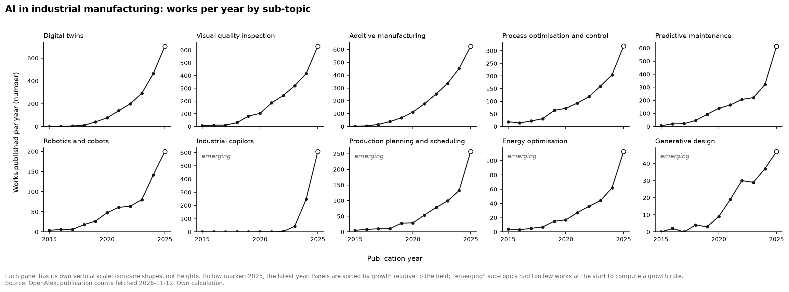
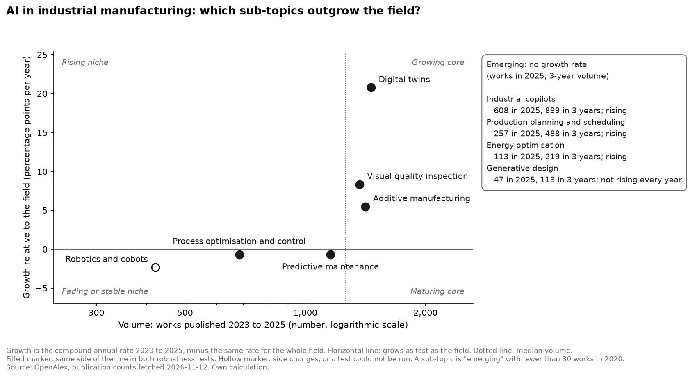

# AI in industrial manufacturing: which application areas are gaining ground?

| | |
|---|---|
| **Type** | Trend scan |
| **Status** | Draft for the project owner's review (see "Open decisions" at the end) |
| **Data** | OpenAlex, fetched 12 November 2026; complete years 2015 to 2025 |
| **Method** | [Trend scan method v1.0](../docs/design/trend-scan-method.md), approved before the data was fetched |
| **Results** | [`trend_metrics.csv`](../data/processed/trend_metrics.csv), [`discovery_top_topics.csv`](../data/processed/discovery_top_topics.csv) |

## Summary

Research on AI in industrial manufacturing grew about 35% a year from 2020 to 2025. Measured against that pace, ten application areas fall into three groups. **Digital twins, visual quality inspection and additive manufacturing** grow faster than the field, and the result holds in every robustness test. **Industrial copilots, production planning and energy optimisation** are too young for a growth rate but have risen every year; copilots went from almost nothing to 608 papers in 2025, yet no production use was confirmed. **Predictive maintenance, process optimisation and robotics** are large and still growing fast, but only at the field's pace. Digital twins lead on both signals: the fastest research growth and the widest industrial use.

**Recommendation:** take seven areas into the opportunity scoring: the six that meet the shortlist rule, plus predictive maintenance as the one permitted exception, because its industrial use is documented.

## 1. Question

Which AI application areas in industrial manufacturing show the strongest momentum, and which deserve a closer evaluation?

The answer feeds the [opportunity scoring model](../tools/opportunity-scoring/), which ranks the shortlisted areas for a reference company.

## 2. Method in brief

- **Signal:** the number of scholarly works per year in OpenAlex, an open index of research publications.
- **Field:** works that mention a manufacturing term and an AI term in their title or abstract. 46,288 works in 2023 to 2025.
- **Sub-topics:** ten application areas, each defined by search terms that must appear in the **title**, on top of the field conditions. The exact filters are recorded with the data ([snapshot note](../data/raw/publication_counts_2026-11-12.meta.json)).
- **Main measure:** growth relative to the field, i.e. a sub-topic's compound annual growth from 2020 to 2025 minus the field's (35.3% a year). Above zero means the area is gaining ground within the field.
- **Emerging:** an area with fewer than 30 works in 2020 gets no growth rate, because a rate from a tiny starting value is meaningless.
- **Robustness:** the main result is recomputed with the window moved one year back (test A), with two-year averages at both ends (test B), for journal articles only (test C) and without the AI terms (test D).
- **Second signal:** an adoption level from 0 to 3 per area, from non-academic sources ([`adoption.csv`](../data/manual/adoption.csv)).
- **Query quality:** each search was checked on a sample of 20 works, rated by two raters; the lower share counts. All ten pass the 70% threshold ([`query_quality.csv`](../data/manual/query_quality.csv)).

The method, its thresholds and the shortlist rule were approved and merged before the first data was fetched, so they could not be tuned to the results.

## 3. Results

### 3.1 The field

| | 2020 | 2024 | 2025 |
|---|---|---|---|
| Works in the field | 4,799 | 14,272 | 21,799 |

The field grew 35.3% a year from 2020 to 2025, and 53% in the last year alone. A check of the source showed that the last jump follows the general rise of AI terms (+45% across all subjects in 2025) rather than growth of the source itself (+16%); see [the source growth check](../data/manual/README.md#findings-of-the-source-growth-check-2026-11-12).

### 3.2 Works per year

### 3.3 Growth relative to the field

| Sub-topic | Works 2020 | Works 2025 | Volume 2023–25 | Growth a year | Versus the field | Robustness | Adoption |
|---|---|---|---|---|---|---|---|
| Digital twins | 76 | 705 | 1,461 | 56.1% | **+20.8** | robust | 3 |
| Visual quality inspection | 103 | 631 | 1,367 | 43.7% | **+8.3** | robust | 2 |
| Additive manufacturing | 113 | 626 | 1,415 | 40.8% | **+5.5** | robust | 1 |
| Process optimisation and control | 72 | 319 | 684 | 34.7% | −0.7 | robust | 2 |
| Predictive maintenance | 139 | 615 | 1,157 | 34.6% | −0.7 | robust | 2 |
| Robotics and cobots | 48 | 200 | 422 | 33.0% | −2.3 | not testable | 2 |
| Industrial copilots | 1 | 608 | 899 | emerging | | | 1 |
| Production planning and scheduling | 29 | 257 | 488 | emerging | | | 2 |
| Energy optimisation | 17 | 113 | 219 | emerging | | | 2 |
| Generative design | 9 | 47 | 113 | emerging | | | 2 |

"Versus the field" is in percentage points a year. "Robust" means the result stays on the same side of the field in tests A and B; it says nothing about whether the result is good.

### 3.4 Robustness tests

Growth relative to the field, in percentage points a year:

| Sub-topic | Main | A: 2019–24 | B: smoothed | C: articles only | D: without AI terms |
|---|---|---|---|---|---|
| Digital twins | +20.8 | +29.5 | +24.1 | +18.2 | +24.8 |
| Visual quality inspection | +8.3 | +5.4 | +7.0 | +7.0 | +35.4 |
| Additive manufacturing | +5.5 | +13.1 | +8.5 | +6.5 | +6.6 |
| Process optimisation and control | −0.7 | −6.8 | −3.4 | +0.5 | +4.9 |
| Predictive maintenance | −0.7 | −5.2 | −2.3 | −2.5 | +19.4 |
| Robotics and cobots | −2.3 | none | +1.1 | −9.0 | +10.6 |

- **The three risers hold in every test.** Their lead is not an artefact of the window, of single years, of preprints or of the AI wording.
- **Robotics** has no result in test A (27 works in 2019, under the threshold of 30) and changes side in test B.
- **Three areas change side without the AI terms** (test D): predictive maintenance, process optimisation and robotics. See section 4.4.
- **Process optimisation** also changes side for articles only (test C), but by less than one point either way: it grows at the field's pace.

### 3.5 Emerging areas

| Sub-topic | 2020 | 2021 | 2022 | 2023 | 2024 | 2025 | Rose each of the last 3 years |
|---|---|---|---|---|---|---|---|
| Industrial copilots | 1 | 1 | 3 | 42 | 249 | 608 | yes |
| Production planning and scheduling | 29 | 54 | 78 | 99 | 132 | 257 | yes |
| Energy optimisation | 17 | 27 | 36 | 44 | 62 | 113 | yes |
| Generative design | 9 | 19 | 30 | 29 | 37 | 47 | no (dip in 2023) |

Production planning missed the threshold by one work. The rule is applied as written; it is a borderline case.

### 3.6 Discovery: what did the list of ten miss?

The fifteen fastest-growing topic labels that OpenAlex itself assigns within the field (at least 30 works in 2020):

| Topic label (OpenAlex) | 2020 | 2025 | Versus the field | Corresponds to |
|---|---|---|---|---|
| Impact of AI and Big Data on Business and Society | 58 | 810 | +34.1 | none: general label |
| **Network Security and Intrusion Detection** | 33 | 250 | +14.6 | **none: missed** |
| Artificial Intelligence Applications | 45 | 300 | +10.8 | none: general label |
| Scheduling and Optimization Algorithms | 74 | 475 | +9.7 | production planning |
| Additive Manufacturing and 3D Printing Technologies | 89 | 538 | +8.0 | additive manufacturing |
| Additive Manufacturing Materials and Processes | 116 | 547 | +1.0 | additive manufacturing |
| Industrial Vision Systems and Defect Detection | 321 | 1,455 | −0.1 | visual quality inspection |
| **Machine Learning in Materials Science** | 68 | 305 | −0.3 | **none: missed** |
| Smart Agriculture and AI | 39 | 169 | −1.3 | none: another sector |
| Reliability and Maintenance Optimization | 63 | 271 | −1.5 | predictive maintenance |
| Digital Transformation in Industry | 501 | 2,050 | −2.8 | none: general label |
| Advanced Neural Network Applications | 60 | 240 | −3.4 | none: a method |
| Manufacturing Process and Optimization | 44 | 172 | −4.0 | process optimisation |
| **Forecasting Techniques and Applications** | 30 | 117 | −4.1 | **none: missed** |
| Machine Fault Diagnosis Techniques | 210 | 759 | −6.0 | predictive maintenance |

Seven labels match a sub-topic. Three point to areas the list did not cover: **security of connected factories**, **AI for materials development**, and **forecasting of demand and production**. As the method requires, they are named as candidates for the next scan, not added to this one.

## 4. Interpretation

### 4.1 Digital twins: the clearest case

The fastest growth relative to the field (+20.8 points), robust in all four tests, and the only area with adoption level 3: in an ARC Advisory Group survey, 33% of participating companies had implemented digital twin and simulation technology ([Siemens blog citing ARC](https://blogs.sw.siemens.com/simcenter/?p=74735)). Research and use point the same way. One caution: its search passed the quality check only at the threshold (14 of 20 relevant for the stricter rater). The misses were digital twins in other sectors such as buildings and supply chains.

### 4.2 Visual quality inspection and additive manufacturing: steady risers

Both grow faster than the field in every test. Visual quality inspection is in documented use: BMW runs camera-based AI quality checks (AIQX) in its plants ([Axis customer story](https://www.axis.com/en-us/customer-story/axis-industrial-vehicle-production)), and quality control is the most-cited AI use case in Rockwell Automation's 2025 survey, with 50% of manufacturers planning to apply AI to it ([Rockwell](https://www.rockwellautomation.com/en-gb/company/news/press-releases/Ninety-Five-Percent-of-Manufacturers-Are-Investing-in-AI-to-Navigate-Uncertainty-and-Accelerate-Smart-Manufacturing.html)). Additive manufacturing shows the opposite gap: rising research, but only adoption level 1. Commercial process control exists ([EOS Smart Fusion](https://www.eos.info/en-us/innovations/smart-fusion)), but no named manufacturer using AI-based control in series production was found. Research is ahead of practice here.

### 4.3 Industrial copilots: the steepest rise, the least use

From 1 work in 2020 to 608 in 2025, most of it after 2023. Commercial products exist (the Siemens Industrial Copilot, with Schaeffler and thyssenkrupp named as early users), but only pilots and planned rollouts were found ([Microsoft and Siemens](https://news.microsoft.com/source/2024/10/24/siemens-and-microsoft-scale-industrial-ai/)). Of large US manufacturers, 24% report generative AI deployed at facility level, but that covers all generative AI, including office use ([Deloitte 2025](https://www.deloitte.com/us/en/insights/industry/manufacturing/2025-smart-manufacturing-survey.html)). This is the pattern a scout looks for: strong research attention, little proven use. It is also the area most exposed to hype, and its search passed the quality check only at the threshold.

### 4.4 Predictive maintenance, process optimisation, robotics: mature, not fading

These three grow about 33% to 35% a year, which only matches the field. Without the AI terms (test D) all three outgrow manufacturing research as a whole, predictive maintenance by 19.4 points. Two readings fit:

- **Different yardsticks.** With AI terms, these areas are measured against a field that grows 35% a year; without them, against manufacturing research that grows 7.5% a year. A topic can trail the first and lead the second.
- **Early adoption.** These areas took up AI methods early, so their AI share was already high in 2020 and had less room to grow than in newer areas.

The counts cannot separate the two. What they do show: these are established, active areas, not declining ones. Their industrial use is documented (adoption level 2 for all three; for predictive maintenance, surveys report 18% to 27% of maintenance teams using it).

### 4.5 Production planning and energy optimisation: small but rising

Both are emerging and rose every year. Production planning has the strongest single piece of adoption evidence in this scan: Lenovo's manufacturer LCFC schedules 43 assembly lines in four plants with deep reinforcement learning, in use since 2019 ([INFORMS](https://www.informs.org/Impact/O.R.-Analytics-Success-Stories/Reinforcement-Learning-Greatly-Improves-Production-Efficiency-in-Large-Manufacturing-Plants)). Energy optimisation rests on a single case: AI kiln control at Heidelberg Materials' Mokrá cement plant, with a 2.2% reduction in specific heat consumption reported after the first month ([Cambridge Enterprise](https://www.enterprise.cam.ac.uk/news/heidelberg-materials-adopts-carbon-res-ai-and-abb-ability-for-improved-kiln-operations/)). That case is from the cement industry and early, so it is thin evidence for a machine builder.

### 4.6 Generative design: small and uneven

The smallest area (47 works in 2025), with a dip in 2023. Industrial use exists, for example a topology-optimised, 3D-printed roof bracket in low-volume series production for the BMW i8 Roadster ([IndustryWeek, 2018](https://www.industryweek.com/technology-and-iiot/article/22026127/with-a-small-but-mighty-bracket-bmw-raises-the-roof-on-3d-printing)), but the research signal is too weak and uneven to support a shortlist place.

## 5. Shortlist and recommendation

Rules from the method, applied in order:

1. Only areas that pass the query-quality check: all ten pass.
2. Areas above the field line and robust: **digital twins, visual quality inspection, additive manufacturing**.
3. Emerging areas that rose in each of the last three years: **industrial copilots, production planning, energy optimisation**.
4. At most one exception from below the field line, if its adoption level is 2 or 3: **predictive maintenance** (confirmed by the project owner; see below).
5. At most eight areas; the list is not padded.

| # | Area | Basis | Reason in one line |
|---|---|---|---|
| 1 | Digital twins | Rule 2 | Fastest riser, robust in all tests, widest industrial use |
| 2 | Visual quality inspection | Rule 2 | Steady riser with documented use in car plants |
| 3 | Additive manufacturing | Rule 2 | Steady riser; research ahead of industrial practice |
| 4 | Industrial copilots | Rule 3 | Steepest rise since 2023; products exist, use unproven |
| 5 | Production planning and scheduling | Rule 3 | Rising every year; deployed at scale at Lenovo |
| 6 | Energy optimisation | Rule 3 | Rising every year; one documented industrial case |
| 7 | Predictive maintenance | Rule 4, exception | Largest of the established areas; documented use (adoption 2); outgrows manufacturing research by 19.4 points without the AI terms |

**Why predictive maintenance as the exception:** three areas qualify (predictive maintenance, process optimisation and robotics all have adoption level 2). Predictive maintenance has the largest volume of the three, the strongest result without the AI terms, and survey evidence of use, where the other two rest on single cases or installation figures.

**Not shortlisted:** process optimisation and robotics (at the field's pace; robotics not robust), generative design (emerging, but its count did not rise every year).

**Recommendation:** evaluate these seven areas in the opportunity scoring for the reference company. In that scoring, the scan suggests two cautions: treat industrial copilots and additive manufacturing as areas where research is ahead of use, and treat energy optimisation's evidence as thin.

## 6. Limitations

1. **Publications are not adoption.** Research attention can run years ahead of industrial use or never lead to it. The adoption levels address this only roughly, and several adoption sources are vendors reporting on their own customers.
2. **Keyword bias.** Results depend on the search terms. Requiring the terms in the title raised precision but lowers recall, so all counts are lower bounds. Terminology shifts over time, and test D shows that wording around AI matters for three areas.
3. **Time lag and the latest year.** Papers appear one to two years after the work. The 2025 counts are unusually high; this follows the general rise of AI wording and new repository content, and cannot be separated from a real increase in research.
4. **Source coverage.** OpenAlex covers English-language work best. Industrial work that is never published is invisible.
5. **Precision was checked, recall was not.** Each search was checked on 20 sampled works by two raters, both sessions of the same AI model. Two shortlisted areas (digital twins, industrial copilots) passed only at the threshold.
6. **Overlap and duplicates.** Sub-topics share works, and some studies are indexed twice (as a preprint and as an article).
7. **One research signal.** No patents, funding or job-market data.
8. **Thresholds are judgements.** The emerging threshold (30 works) and the quality threshold (70%) were fixed in advance; production planning missed the first by one work.

## 7. Sources

**Data**

- OpenAlex, publication counts fetched 12 November 2026: [`data/raw/`](../data/raw/)
- Adoption sources with check dates: [`data/manual/adoption.csv`](../data/manual/adoption.csv)

**Cited in the interpretation**

- ARC Advisory Group survey, via Siemens Simcenter blog: https://blogs.sw.siemens.com/simcenter/?p=74735
- Axis Communications, BMW Group customer story: https://www.axis.com/en-us/customer-story/axis-industrial-vehicle-production
- Rockwell Automation, State of Smart Manufacturing 2025: https://www.rockwellautomation.com/en-gb/company/news/press-releases/Ninety-Five-Percent-of-Manufacturers-Are-Investing-in-AI-to-Navigate-Uncertainty-and-Accelerate-Smart-Manufacturing.html
- EOS, Smart Fusion: https://www.eos.info/en-us/innovations/smart-fusion
- Microsoft and Siemens, 2024: https://news.microsoft.com/source/2024/10/24/siemens-and-microsoft-scale-industrial-ai/
- Deloitte, 2025 Smart Manufacturing Survey: https://www.deloitte.com/us/en/insights/industry/manufacturing/2025-smart-manufacturing-survey.html
- INFORMS, Lenovo case: https://www.informs.org/Impact/O.R.-Analytics-Success-Stories/Reinforcement-Learning-Greatly-Improves-Production-Efficiency-in-Large-Manufacturing-Plants
- Cambridge Enterprise, Heidelberg Materials and Carbon Re: https://www.enterprise.cam.ac.uk/news/heidelberg-materials-adopts-carbon-res-ai-and-abb-ability-for-improved-kiln-operations/
- IndustryWeek, BMW i8 Roadster bracket, 2018: https://www.industryweek.com/technology-and-iiot/article/22026127/with-a-small-but-mighty-bracket-bmw-raises-the-roof-on-3d-printing
- Fluke survey on predictive maintenance, via Automation.com: https://www.automation.com/article/fluke-survey-predictive-maintenance-adoption-doubles-manufacturers-boost-digital-investment
- MaintainX survey, via Relia Mag: https://reliamag.com/maintenance-and-reliability/predictive-maintenance-adoption-rates/

---

## Open decisions for the project owner

This section is removed once the draft is approved.

Decided on 13 November 2026: the project owner confirmed all seven areas, with predictive maintenance as the exception under rule 4.

1. **The discovery mapping.** Confirm [`discovery_mapping.csv`](../data/manual/discovery_mapping.csv), in particular "machine fault diagnosis" counted as predictive maintenance, and "network security" treated as a missed area.
2. **The summary and interpretation.** Drafted by the AI assistant from the data. Check that each statement says what you would say, and rewrite in your own words where it does not.
