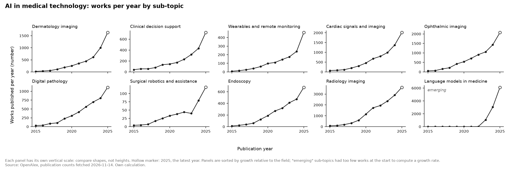
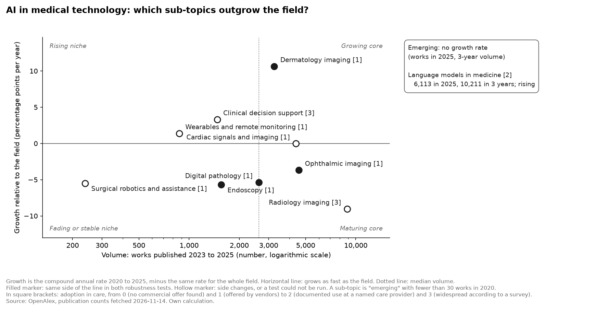

# AI in medical technology: which application areas are gaining ground?

| | |
|---|---|
| **Type** | Trend scan (the second in this repository) |
| **Status** | Draft by the AI assistant. Nothing in it has been reviewed by the project owner yet (see "Open decisions" at the end) |
| **Data** | OpenAlex, fetched 14 November 2026; complete years 2015 to 2025 |
| **Method** | [Trend scan method v1.0](../docs/design/trend-scan-method.md), unchanged from the [first scan](2026-11_ai-in-industrial-manufacturing.md), so the two can be compared |
| **Results** | [`trend_metrics.csv`](../data/processed/medtech/trend_metrics.csv), [`trend_counts_by_year.csv`](../data/processed/medtech/trend_counts_by_year.csv), [`discovery_top_topics.csv`](../data/processed/medtech/discovery_top_topics.csv) |

## Summary

**Question:** which AI application areas in medical technology are gaining ground, and which deserve a closer look?

Research on AI in medicine grew about 35% a year from 2020 to 2025, the same pace as in manufacturing. One area explains much of it: **language models in medicine** went from no papers in 2020 to 6,113 in 2025, more than any other area, and are already in routine use for clinical notes at large hospital groups. Of the nine established areas, only **dermatology imaging** clearly outgrows the field. The classic imaging areas (radiology, pathology, eye, endoscopy) grow more slowly than the field. Research growth and use run in opposite directions: radiology is the most widely used and among the slowest growing.

**Recommendation:** look closer at three areas: language models, dermatology imaging, and radiology imaging as the one permitted exception: it is the most used, and 2020 distorts its growth figure.

## 1. Question

Which AI application areas in medical technology show the strongest momentum, and which deserve a closer evaluation?

This scan repeats the first one for another sector. It does not feed a scoring model.

## 2. Method in brief

The method, thresholds and shortlist rule are those approved for the first scan and were not changed. What is specific to this scan:

- **Field:** works that mention a clinical or medical-device term (patient, clinical, medical device, medical imaging, radiology, histopathology, surgery) and an AI term in their title or abstract. 250,815 works in 2023 to 2025. This is AI in clinical medicine broadly; the ten sub-topics pick out device and diagnostic applications within it.
- **Sub-topics:** ten application areas, each with search terms that must appear in the title. The filters are recorded with the data ([snapshot note](../data/raw/medtech/publication_counts_2026-11-14.meta.json)).
- **Order:** the searches were checked and fixed on sampled titles before any counts were fetched.
- **Adoption:** the scale of the first scan, with care providers in place of manufacturers. Level 1 is a product authorised by a regulator; level 2 is routine use at a named provider; level 3 is a survey in which at least 25% of hospitals or clinicians report use. This adaptation was made by the assistant and is not yet decided by the owner.

## 3. Results

### 3.1 The field

| | 2019 | 2020 | 2024 | 2025 |
|---|---|---|---|---|
| Works in the field | 18,606 | 26,632 | 77,466 | 118,267 |

The field grew 34.7% a year from 2020 to 2025. The first scan found 35.3% for AI in manufacturing. Two unrelated sectors growing at the same pace suggests that the pace belongs to AI research as a whole, not to either sector.

### 3.2 Works per year

### 3.3 Growth relative to the field

| Sub-topic | Works 2020 | Works 2025 | Volume 2023–25 | Growth a year | Versus the field | Robustness | Adoption |
|---|---|---|---|---|---|---|---|
| Dermatology imaging | 251 | 1,630 | 3,240 | 45.4% | **+10.6** | robust | 1 |
| Clinical decision support | 144 | 722 | 1,473 | 38.0% | +3.3 | not robust | 3 |
| Wearables and remote monitoring | 98 | 458 | 873 | 36.1% | +1.4 | not robust | 1 |
| Cardiac signals and imaging | 454 | 2,014 | 4,378 | 34.7% | 0.0 | not robust | 1 |
| Ophthalmic imaging | 536 | 2,073 | 4,554 | 31.1% | −3.7 | robust | 1 |
| Digital pathology | 307 | 1,113 | 2,617 | 29.4% | −5.4 | robust | 1 |
| Surgical robotics and assistance | 33 | 119 | 238 | 29.2% | −5.5 | not testable | 1 |
| Endoscopy | 189 | 676 | 1,561 | 29.0% | −5.7 | robust | 1 |
| Radiology imaging | 1,154 | 3,622 | 8,880 | 25.7% | −9.0 | not robust | 3 |
| Language models in medicine | 0 | 6,113 | 10,211 | emerging | | | 2 |

"Versus the field" is in percentage points a year. "Robust" means the result stays on the same side of the field in tests A and B.

### 3.4 Robustness tests

Growth relative to the field, in percentage points a year:

| Sub-topic | Main | A: 2019–24 | B: smoothed | C: articles only | D: without AI terms |
|---|---|---|---|---|---|
| Dermatology imaging | +10.6 | +6.9 | +9.1 | +11.8 | +3.0 |
| Clinical decision support | +3.3 | −6.3 | −0.9 | +8.1 | +11.4 |
| Wearables and remote monitoring | +1.4 | −2.0 | +0.2 | −3.7 | +19.5 |
| Cardiac signals and imaging | 0.0 | +2.2 | +0.9 | +2.1 | +1.3 |
| Ophthalmic imaging | −3.7 | −5.4 | −4.5 | −5.4 | +0.2 |
| Digital pathology | −5.4 | −4.1 | −4.9 | −4.6 | +6.0 |
| Surgical robotics and assistance | −5.5 | none | none | none | +8.4 |
| Endoscopy | −5.7 | −2.5 | −4.4 | −3.0 | +0.1 |
| Radiology imaging | −9.0 | **+4.5** | −3.8 | −7.3 | −0.3 |

- **Only dermatology imaging is above the field in all four tests.**
- **Radiology flips with the base year.** Its count nearly doubled from 2019 to 2020 (590 to 1,154), the first year of the COVID-19 pandemic, when chest imaging was studied intensively. Measured from that inflated year, its growth looks low; measured from 2019, it is above the field. The robustness label catches this.
- **Surgical robotics is too small to test**: 33 works in 2020, and under the threshold of 30 in tests A, B and C.

### 3.5 The emerging area

| Sub-topic | 2020 | 2021 | 2022 | 2023 | 2024 | 2025 |
|---|---|---|---|---|---|---|
| Language models in medicine | 0 | 1 | 16 | 1,053 | 3,045 | 6,113 |

In 2025 this single area produced more works than radiology imaging (3,622), the largest established area. Its three-year volume (10,211) is also the largest of the ten.

### 3.6 Query quality

A random sample of 20 works per sub-topic from 2023 to 2025, rated by two raters from the titles. The lower share counts; the threshold is 70%.

| Sub-topic | Relevant, rater 1 | Relevant, rater 2 | Share that counts | Result |
|---|---|---|---|---|
| Digital pathology | 19 of 20 | 20 of 20 | 95% | pass |
| Clinical decision support | 19 of 20 | 18 of 20 | 90% | pass |
| Dermatology imaging | 17 of 20 | 17 of 20 | 85% | pass |
| Cardiac signals and imaging | 17 of 20 | 18 of 20 | 85% | pass |
| Endoscopy | 17 of 20 | 18 of 20 | 85% | pass |
| Radiology imaging | 16 of 20 | 17 of 20 | 80% | pass |
| Ophthalmic imaging | 16 of 20 | 17 of 20 | 80% | pass |
| Surgical robotics and assistance | 16 of 20 | 18 of 20 | 80% | pass |
| Wearables and remote monitoring | 17 of 20 | 15 of 20 | 75% | pass |
| Language models in medicine | 14 of 20 | 15 of 20 | 70% | pass, at the threshold |

The raters agree on 189 of 200 works (94.5%; Cohen's kappa 0.78). Both are sessions of the same AI model.

Three rounds were needed ([`query_quality.csv`](../data/manual/medtech/query_quality.csv)). The first field definition used the bare words "diagnosis" and "wearable". "Diagnosis" also matches machine fault diagnosis, and the source reduces "wearable" to the stem "wear", which matches papers on the wear of tools and materials: 5 of the first 20 "wearables" results were about that. The field was narrowed, and three searches were tightened, before any counts were fetched.

### 3.7 Discovery: what did the list of ten miss?

The fifteen fastest-growing topic labels that OpenAlex assigns within the field (at least 30 works in 2020):

| Topic label (OpenAlex) | 2020 | 2025 | Versus the field | Corresponds to |
|---|---|---|---|---|
| **Pharmacovigilance and Adverse Drug Reactions** | 48 | 595 | +30.7 | **none: missed** (drug safety; medicines, not devices) |
| Artificial Intelligence in Healthcare and Education | 1,186 | 13,672 | +28.3 | none: general label |
| **Digital Mental Health Interventions** | 34 | 383 | +27.6 | **none: missed** |
| Privacy-Preserving Technologies in Data | 97 | 942 | +22.8 | none: a method |
| Dental Radiography and Imaging | 113 | 1,091 | +22.6 | radiology imaging |
| Blockchain Technology Applications and Security | 36 | 341 | +22.0 | none: a method |
| Cancer Immunotherapy and Biomarkers | 60 | 454 | +15.2 | none: organised by disease |
| Internet of Things and AI | 104 | 776 | +14.7 | none: general label |
| Explainable Artificial Intelligence (XAI) | 142 | 1,053 | +14.6 | none: a method |
| Lung Cancer Diagnosis and Treatment | 35 | 248 | +13.2 | radiology imaging |
| Ethics and Social Impacts of AI | 50 | 348 | +12.7 | none: general label |
| Head and Neck Cancer Studies | 32 | 208 | +10.7 | none: organised by disease |
| Topic Modeling | 30 | 192 | +10.2 | none: a method |
| Hepatocellular Carcinoma Treatment and Prognosis | 49 | 313 | +10.2 | none: organised by disease |
| Bone health and osteoporosis research | 31 | 185 | +8.2 | none: organised by disease |

- **Two areas the list missed:** monitoring of drug safety, and digital mental health. Both are named as candidates for a next scan.
- **One area hidden inside a sub-topic:** dental imaging grows 22.6 points faster than the field, while radiology imaging as a whole is below it.
- **The labels fit this sector poorly.** Most are organised by disease or by method, not by device or application, so only two of fifteen correspond to a sub-topic. In the manufacturing scan seven did. The discovery step is a weaker check here.

## 4. Interpretation

### 4.1 Language models: the area that moves the field

No other area in either scan rose like this: from nothing to the largest in three years. Unlike in manufacturing, use has followed quickly. AI note-taking during patient visits is in routine use at named hospital groups: more than 3,000 providers at Mass General Brigham by April 2025 ([Harvard Gazette](https://news.harvard.edu/gazette/story/2025/08/physicians-embrace-ai-note-taking-technology/)), and 7,260 physicians at Kaiser Permanente over 2.5 million visits ([News-Medical](https://www.news-medical.net/news/20250822/How-generative-AI-scribes-are-reducing-physician-burnout.aspx)). That use is documentation, not diagnosis: the evidence does not show language models in routine diagnostic use. Two cautions: the search passed the quality check only at the threshold, and many of the papers evaluate a chatbot on exam questions or patient information, which is research attention more than device development.

### 4.2 Dermatology imaging: research ahead of practice

The only established area that outgrows the field in every test (+10.6 points). In practice it is at the start: the first AI device for evaluating skin lesions was cleared in the United States in January 2024, and it works with light spectroscopy, not images ([Fierce Biotech](https://www.fiercebiotech.com/medtech/fda-clears-handheld-ai-powered-optical-probe-evaluating-lesions-skin-cancer)). Much research on a problem that needs only a camera, and little authorised product: the same pattern as additive manufacturing in the first scan.

### 4.3 Radiology and decision support: used widely, growing slowly

These two are the only areas at adoption level 3. About three quarters of all AI devices authorised by the US regulator are for radiology ([analysis of the FDA list](https://medicalfuturist.com/the-current-state-of-fda-approved-ai-based-medical-devices)), and 40% of surveyed European radiologists had hands-on clinical experience with AI ([European Society of Radiology survey](https://pmc.ncbi.nlm.nih.gov/articles/PMC9213582)). About 71% of US hospitals report predictive AI built into their patient record systems ([American Hospital Association](https://www.aha.org/aha-center-health-innovation-market-scan/2025-11-04-4-actions-close-hospitals-predictive-ai-gap)).

Yet radiology is the slowest-growing area and decision support is not robustly above the field. Across the ten areas, research growth and adoption run in opposite directions. That is what a maturing technology looks like: the research question moves on once products exist. For a scout, low growth in a large, widely used area is not a warning sign.

### 4.4 The imaging family: four areas, one pattern

Ophthalmic imaging, digital pathology and endoscopy all sit 4 to 6 points below the field, robustly. Each has an authorised product and no evidence of broad use. They are neither rising nor mature: established research areas whose route into practice is slow.

### 4.5 Where the two scans agree

| | Manufacturing | Medical technology |
|---|---|---|
| Growth of the field, 2020 to 2025 | 35.3% a year | 34.7% a year |
| Language models | 1 work in 2020, 608 in 2025; pilots only | 0 works in 2020, 6,113 in 2025; routine use for documentation |
| Research ahead of practice | Additive manufacturing | Dermatology imaging |
| Widely used, growing at or below the field | Predictive maintenance | Radiology, decision support |
| Effect of a search word with a second meaning | none found | "wearable" matched tool wear |

In both sectors, language models are the steepest rise, and in both the most widely used area is not the fastest growing. The medical field is about five times larger in volume and further along in using language models.

## 5. Shortlist

The rule of the method, applied in order:

1. Only areas that pass the query-quality check: all ten pass.
2. Above the field line and robust: **dermatology imaging**.
3. Emerging and rising in each of the last three years: **language models in medicine**.
4. At most one exception from below the field line, with adoption level 2 or 3: **radiology imaging** (proposed).
5. At most eight; the list is not padded.

| # | Area | Basis | Reason in one line |
|---|---|---|---|
| 1 | Language models in medicine | Rule 3 | Largest and fastest-rising area; already in routine use for documentation |
| 2 | Dermatology imaging | Rule 2 | The only established area above the field in all tests; products only just arriving |
| 3 | Radiology imaging | Rule 4, exception | Largest established area and the most widely used; its low growth figure depends on the pandemic year 2020 |

Three areas, not five to eight. The rule forbids padding, and in this sector it finds little that clearly stands out. Clinical decision support is above the field and widely used, but its result changes side in two tests, and the exception rule covers only areas below the line.

## 6. Limitations

1. **Publications are not adoption**, and here the adoption evidence is weaker than in the first scan: a regulator's authorisation shows that a product may be sold, not that it is used.
2. **Keyword bias.** The searches require terms in the title, so counts are lower bounds. One search word had a second meaning that the quality check caught; others may not have been caught.
3. **Time lag and special years.** The pandemic year 2020 is the base year of the growth window and distorts at least radiology. The 2025 counts are high across the source.
4. **Source coverage.** English-language work dominates. Adoption sources are mostly from the United States.
5. **Precision was checked, recall was not**, and the check used titles only. Both raters were sessions of the same AI model.
6. **Overlap and duplicates.** Sub-topics share works, and some studies are indexed twice.
7. **The field is broad.** It covers AI in clinical medicine, not only devices. The sub-topics are small parts of it, and "share of the field" is not meaningful here.
8. **Three adoption rows rest on the assistant's memory** of a regulatory authorisation (ophthalmic imaging, endoscopy, wearables), because the search found no source. They are marked in [`adoption.csv`](../data/manual/medtech/adoption.csv) and need checking.
9. **The discovery step is weak in this sector**, because the source's topic labels follow diseases and methods.

## 7. Sources

**Data**

- OpenAlex, fetched 14 November 2026: [`data/raw/medtech/`](../data/raw/medtech/)
- Adoption sources with check dates and reservations: [`data/manual/medtech/adoption.csv`](../data/manual/medtech/adoption.csv)

**Cited in the interpretation** (found by web search; the pages were not opened)

- Harvard Gazette, 2025, on AI note-taking at Mass General Brigham: https://news.harvard.edu/gazette/story/2025/08/physicians-embrace-ai-note-taking-technology/
- News-Medical, 2025, on AI scribes at Kaiser Permanente: https://www.news-medical.net/news/20250822/How-generative-AI-scribes-are-reducing-physician-burnout.aspx
- Fierce Biotech, 2024, on the clearance of DermaSensor: https://www.fiercebiotech.com/medtech/fda-clears-handheld-ai-powered-optical-probe-evaluating-lesions-skin-cancer
- The Medical Futurist, analysis of the FDA list of AI-enabled devices: https://medicalfuturist.com/the-current-state-of-fda-approved-ai-based-medical-devices
- European Society of Radiology member survey, 2022: https://pmc.ncbi.nlm.nih.gov/articles/PMC9213582
- American Hospital Association, 2025, on predictive AI in hospitals: https://www.aha.org/aha-center-health-innovation-market-scan/2025-11-04-4-actions-close-hospitals-predictive-ai-gap

---

## Open decisions for the project owner

This section is removed once the draft is approved.

1. **The adoption rule for this sector.** The assistant carried over the 25% rule with care providers in place of manufacturers, and counted a regulatory authorisation as level 1. Confirm or change.
2. **The exception (rule 4).** Radiology imaging is proposed. The alternative is no exception, which leaves two areas.
3. **The three adoption rows from memory.** Check ophthalmic imaging, endoscopy and wearables against a source, or lower them.
4. **The choice of sub-topics and the field definition.** Both were made by the assistant without your input.
5. **The discovery mapping** in [`discovery_mapping.csv`](../data/manual/medtech/discovery_mapping.csv).
6. **The text.** Everything here is the assistant's first draft.
